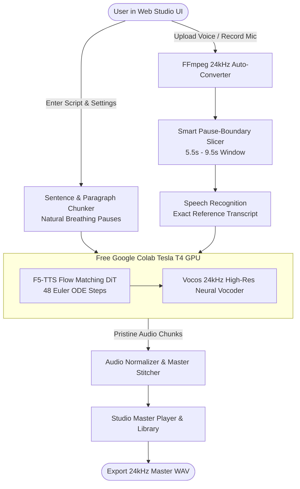

# 🎙️ VoiceStudio — Professional AI Voice Cloning & Studio Voiceover

<div align="center">


<p align="center">
  <strong>Zero-shot voice cloning and long-form voiceover suite powered by F5-TTS flow-matching diffusion and free cloud GPU acceleration. Clone any voice with 10–20 seconds of audio.</strong>
</p>

</div>

---

## 🌟 Key Highlights

- **🎯 Exact Zero-Shot Voice Cloning:** Clone any voice's pitch, timbre, vocal resonance, and regional accent (English, Telugu, Hindi, and more) from a short reference audio sample.
- **⚡ Zero Local GPU Required:** Runs with full hardware acceleration on free **Google Colab Tesla T4 GPUs (16 GB VRAM)** via a secure 1-click Gradio live tunnel.
- **✂️ Smart Pause-Boundary Detection:** Eliminates mid-word cuts by automatically identifying low-energy silence boundaries (5.5s–9.5s) for clean reference phoneme alignment.
- **🔬 48-Step Euler ODE Resolution:** Configured for high-fidelity flow matching ODE steps, capturing crisp consonants (`s`, `t`, `k`), chest timbre, and huskiness without metallic vocoder artifacts.
- **📜 Multi-Paragraph Voiceover Cadence:** Seamlessly chunks long multi-paragraph scripts (2+ minutes) and stitches them with natural 360ms human breathing pauses.
- **🚀 Indian Studio Neural Engine:** Built-in instant Microsoft Edge Neural TTS voices for Telugu, Hindi, and Indian English with 1-second generation and zero quota limits.
- **🧹 Full Audio Library Management:** Dedicated single-click delete and bulk-clear controls for reference voice samples and production master files.
- **🛡️ 100% User Ownership & Ethical AI:** Full legal guidance and ownership guarantees for all synthesized content.

---

## 📐 System Architecture



---

## 🚀 1-Click Free Cloud GPU Setup (Google Colab)

To generate long voiceovers with zero local GPU usage and zero Hugging Face rate limits:

1. Open [Google Colab](https://colab.research.google.com).
2. Set Runtime to GPU: **Runtime > Change runtime type > T4 GPU**.
3. Create a code cell and run:
   ```bash
   !pip install -q f5-tts gradio soundfile
   !f5-tts_infer-gradio --share
   ```
4. Copy the public Gradio URL (e.g., `https://xxxxxxxx.gradio.live`).
5. In VoiceStudio, click **⚡ Connect Cloud GPU** in the top navigation, paste your URL, and click **Save & Connect GPU**.

> [!TIP]
> Google Colab provides a free Tesla T4 GPU with 15–16 GB VRAM. Generations complete in ~1–2 seconds per sentence with zero quota lockouts!

---

## 🎙️ Voice Matching Quality Guide

To achieve an exact **1:1 vocal match** for any voice:

| Factor | Recommended Practice | Why It Matters |
| :--- | :--- | :--- |
| **Clean Background** | Record in a quiet room or upload audio with **zero background music** | AI flow-matching clones everything in the audio spectrum, including background noise and reverb. |
| **Speaking Speed** | For fast speakers (like podcast reels), set the UI **Speed slider to `0.85x`–`0.90x`** | Slows down phoneme pacing into clear, relaxed narrative speech without changing pitch. |
| **Exact Transcript** | Verify the text in **Reference Audio Transcript** matches the reference clip | F5-TTS uses cross-attention between reference audio and reference text to calibrate phonemes. |
| **Reference Length** | Upload 15–30 seconds of conversational speech | The smart slicer selects the optimal 6–9 second sentence for vocal timbre calibration. |

---

## 💻 Local Installation (Windows / macOS / Linux)

### Prerequisites
- Python 3.10, 3.11, or 3.12
- [FFmpeg](https://ffmpeg.org/) (installed and available on system PATH)

### Quick Start
```bash
# 1. Clone the repository
git clone https://github.com/kalyan-1845/voice-studio.git
cd voice-studio

# 2. Create virtual environment
python -m venv .venv

# 3. Activate virtual environment
# Windows:
.\.venv\Scripts\activate
# Linux/macOS:
source .venv/bin/activate

# 4. Install dependencies
pip install -r requirements.txt

# 5. Launch VoiceStudio
python -m uvicorn backend.app:app --host 127.0.0.1 --port 7860
```
Open your browser to `http://127.0.0.1:7860`.

---

## 📁 Project Structure

```
voice-studio/
├── backend/
│   ├── app.py                 # FastAPI REST API & WebSocket server
│   ├── config.py              # Environment configuration & dynamic settings
│   ├── audio_utils.py         # Pause-boundary detection, FFmpeg conversion, & pitch estimation
│   └── tts_engine.py          # F5-TTS cloud client (48 Euler steps) & Edge Neural engine
├── static/
│   ├── index.html             # Studio dark glassmorphism dashboard
│   ├── css/style.css          # Design system, animations, & responsive styles
│   └── js/app.js              # In-browser audio recording, playback, & library state
├── uploads/                   # Calibrated voice profiles
├── outputs/                   # Master synthesized audio productions
├── Voice_Studio_GPU_Colab.ipynb # 1-click Google Colab notebook
├── COPYRIGHT_AND_LEGAL.md     # Intellectual property & ethical AI policy
├── LICENSE                    # MIT License
└── requirements.txt           # Python dependencies
```

---

## ⚖️ Copyright & Legal Ownership

- **100% User Ownership:** You retain full ownership, copyright, and commercial distribution rights over all voiceover scripts you submit and the resulting audio files generated by VoiceStudio.
- **Consent & Ethical AI:** You must have explicit consent or rights to any voice sample you upload or clone. Voice cloning may not be used for fraudulent impersonation, deceptive media, harassment, or unlawful activities.
- Read our full policy in [COPYRIGHT_AND_LEGAL.md](COPYRIGHT_AND_LEGAL.md).

---

## 📜 License & Community

This project is licensed under permissive open-source terms. See [COPYRIGHT_AND_LEGAL.md](COPYRIGHT_AND_LEGAL.md) for full intellectual property and ethical usage guidelines.
